# Arquitectura de agentes, herramientas y MCP

```mermaid
flowchart TD
    %% ===== Fuentes externas =====
    subgraph EXT["Fuentes externas"]
        GH["GitHub Projects v2"]
        MCPSRV["Servidor MCP Proyectos<br/>PROJECTS_MCP_URL, endpoint /mcp"]
        COPILOT["GitHub Copilot SDK<br/>modelo COPILOT_MODEL"]
        OASPEC["client/openapi<br/>contratos externos (carpeta no presente)"]
    end

    %% ===== Orquestador =====
    subgraph ORQ["Orquestador main.py"]
        MAIN["main.py<br/>flujo HITL por etapa"]
        WF["crew/workflow.py<br/>ROLES y DATA_ROLES"]
        GUARD["guard_input<br/>anti prompt injection y redaccion de secretos"]
        CKPT[("output/.checkpoint.json")]
        HITL{{"Humano<br/>s aprobar, r reintentar, n abortar"}}
    end

    %% ===== Cliente MCP =====
    subgraph MCPC["Cliente MCP mcp_projects.py"]
        LP["list_projects"]
        LPI["list_project_items"]
        GF["get_feature_from_item"]
    end

    %% ===== LLM =====
    subgraph LLMS["Capa LLM"]
        CLLM["CopilotLLM<br/>crew/copilot_llm.py"]
        RT["lab_copilot/runtime.py<br/>streaming en terminal"]
    end

    %% ===== Agentes CrewAI =====
    subgraph AGENTS["Agentes CrewAI, en orden"]
        SP["1 specifier<br/>OpenSpec proposal y specs"]
        AR["2 architect<br/>load_issue, diagramas, OpenAPI, tareas"]
        DA["data<br/>opcional, CREWAI_INCLUDE_DATA"]
        BE["3 backend<br/>bucle de herramientas"]
        FE["4 frontend<br/>Angular"]
        TE["5 testing<br/>pytest API y Selenium E2E"]
        SE["6 security"]
        CH["7 chapter"]
    end

    %% ===== Herramientas del backend =====
    subgraph TOOLS["Herramientas de backend y frontend crew/dev_loop.py"]
        DL["run_dev_loop<br/>12 iteraciones backend, 20 frontend"]
        FSTOOLS["write_file, read_file, list_files"]
        RUNTOOLS["backend: run_pytest, run_ruff<br/>frontend: run_npm_install, run_ng_build, run_ng_test"]
        FIN["finish<br/>solo si los gates estan en verde"]
    end

    %% ===== Persistencia y validacion =====
    subgraph OUT["Entregables y validacion"]
        CHG["openspec/changes/feature/<br/>design.md, tasks.md, openapi.yaml, specs, reports"]
        CODE["openspec/changes/feature/code/backend<br/>app y tests"]
        OSCLI["OpenSpec CLI<br/>openspec validate"]
        GUARDOUT["check_output<br/>guardrails por rol"]
    end

    %% ===== Conexiones =====
    GH --> MCPSRV
    MCPSRV --> LP
    MCPSRV --> LPI
    MCPSRV --> GF
    MAIN -->|"elegir proyecto"| LP
    MAIN -->|"elegir item"| LPI
    MAIN --> GUARD
    GUARD --> AR
    AR -->|"load_issue"| GF

    MAIN --> WF
    WF --> SP
    WF --> AR
    WF --> DA
    WF --> BE
    WF --> FE
    WF --> TE
    WF --> SE
    WF --> CH

    SP -->|"run_role"| CLLM
    AR -->|"run_role"| CLLM
    DA -->|"run_role"| CLLM
    FE -->|"develop"| DL
    TE -->|"run_role"| CLLM
    SE -->|"run_role"| CLLM
    CH -->|"run_role"| CLLM
    BE -->|"develop"| DL

    DL -->|"prompt y respuesta"| CLLM
    CLLM --> RT
    RT --> COPILOT
    AR -.->|"lee contratos"| OASPEC
    MAIN -.->|"read_openapi"| OASPEC

    DL --> FSTOOLS
    DL --> RUNTOOLS
    DL --> FIN
    FSTOOLS --> CODE
    RUNTOOLS -->|"python -m pytest y ruff"| CODE

    SP --> CHG
    AR --> CHG
    DA --> CHG
    FE --> CHG
    TE --> CHG
    SE --> CHG
    CH --> CHG
    BE --> CHG
    CHG --> GUARDOUT
    GUARDOUT --> OSCLI

    MAIN --> HITL
    HITL -->|"r feedback"| MAIN
    HITL -->|"s aprobado"| CKPT
    CKPT --> MAIN
    MAIN -->|"fin del flujo"| OSCLI
```

## Cómo leerlo

- **Entrada:** `main.py` elige proyecto e item con el MCP. `architect.load_issue` lee el issue con `get_feature_from_item`. Ningún agente llama al MCP mientras trabaja.
- **Agentes:** siete roles en orden, más `data` si `CREWAI_INCLUDE_DATA=true`. Todos usan `CopilotLLM`, que transmite la salida a la terminal.
- **Herramientas:** backend y frontend usan herramientas a través de `crew/dev_loop.py`: escribir y leer archivos, ejecutar sus gates y `finish`. Backend ejecuta pytest y ruff; frontend ejecuta npm install, `ng build` y `ng test`. El resto de roles responde en texto.
- **Contratos externos:** los prompts de architect y backend mencionan `client/openapi/`, pero esa carpeta no existe en el repo; el diagrama la muestra con línea punteada para indicarlo.
- **Código:** backend en `openspec/changes/<nombre-del-cambio>/code/backend/` (`app/` y `tests/`); frontend en `code/frontend/`.
- **Validación:** cada salida pasa por `check_output` y se guarda en el cambio de OpenSpec. Al final se corre `openspec validate`.
- **HITL:** cada etapa necesita aprobación antes de avanzar. El estado queda en `output/.checkpoint.json`.
