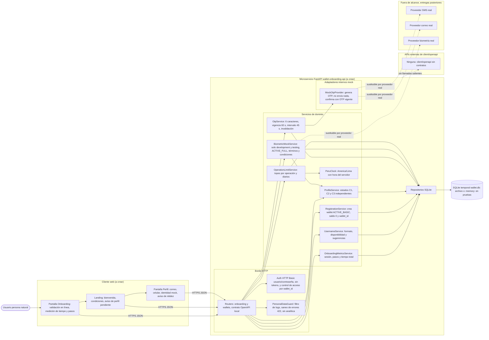

# Diseño

## Arquitectura



## Secuencia

```mermaid
sequenceDiagram
    autonumber
    actor U as Usuario
    participant FE as Frontend SPA
    participant API as FastAPI wallet-onboarding-api
    participant SVC as Servicios de dominio
    participant OTP as MockOtpProvider
    participant DB as SQLite temporal
    participant EXT as Pasarelas externas

    Note over API,EXT: client/openapi no tiene contratos. No se invoca ninguna pasarela externa (SMS, correo o biometría real).

    rect rgb(235, 245, 255)
    Note over U,DB: 1. Onboarding y medición CA-01
    U->>FE: Abre la pantalla de onboarding (visible)
    FE->>API: POST /onboarding/sessions
    API->>SVC: iniciar medición
    SVC->>DB: INSERT onboarding_sessions (started_at)
    API-->>FE: 201 session_id
    loop Por cada campo (validación local en línea)
        U->>FE: Escribe el valor
        FE->>FE: Valida formato y robustez, muestra resultado
        opt Campo Usuario
            FE->>API: POST /onboarding/username-availability
            API->>SVC: validar formato y disponibilidad
            SVC->>DB: SELECT username_normalized
            alt No disponible
                SVC->>DB: SELECT candidatos (nombres, apellidos, números, sin símbolos)
                API-->>FE: 200 TAKEN con suggestions disponibles
            else Disponible
                API-->>FE: 200 AVAILABLE
            end
        end
        FE->>API: POST /onboarding/sessions/:id/steps
        API->>DB: INSERT onboarding_steps (step, elapsed_ms)
        API-->>FE: 201
    end
    end

    rect rgb(240, 255, 240)
    Note over U,DB: 2. Registro y cuenta básica CA-02, CA-03, CA-04
    U->>FE: Envía el formulario
    FE->>API: POST /onboarding/registrations
    API->>API: Valida campos (422 sin eco de valores)
    API->>SVC: registrar
    SVC->>DB: BEGIN
    SVC->>DB: INSERT wallet_accounts (wallet_id, hash de contraseña, ACTIVE_BASIC, saldo 0)
    SVC->>DB: INSERT wallet_profiles (PENDING_EMAIL, PENDING_MOVIL, PENDING_BIOM)
    SVC->>DB: UPDATE onboarding_sessions (completed_at, total_duration_ms)
    SVC->>DB: COMMIT
    alt Usuario ya registrado
        API-->>FE: 409 USERNAME_TAKEN con suggestions
    else Registro correcto
        API-->>FE: 201 wallet_id, ACTIVE_BASIC, saldo 0, nombres, condiciones, duración
        FE->>U: Landing con bienvenida por nombre, condiciones y aviso de perfil pendiente
    end
    end

    rect rgb(255, 250, 235)
    Note over U,DB: 3. Validación de correo CA-06, CA-07 (celular CA-08 es análogo con phone)
    U->>FE: Ingresa correo
    FE->>API: POST /wallets/:id/profile/email/otp-requests (Basic)
    API->>API: Autentica usuario y verifica wallet_id propio
    API->>SVC: solicitar OTP
    SVC->>DB: SELECT correo en otro wallet y último OTP
    alt Formato inválido
        API-->>FE: 422 INVALID_EMAIL_FORMAT
    else Correo de otro usuario
        API-->>FE: 409 EMAIL_ALREADY_REGISTERED
    else Pasaron menos de 45 s
        API-->>FE: 429 OTP_RATE_LIMITED con Retry-After
    else Solicitud permitida
        SVC->>DB: UPDATE otp_challenges SET INVALIDATED (anteriores)
        SVC->>OTP: generar(destino)
        OTP-->>SVC: código de 6 caracteres (no se envía)
        SVC->>DB: INSERT otp_challenges (expires_at = now + 60 s)
        API-->>FE: 201 expires_at, next_request_allowed_at
    end
    U->>FE: Ingresa cualquier valor de OTP
    FE->>API: POST /wallets/:id/profile/email/otp-confirmations
    API->>SVC: confirmar
    SVC->>DB: SELECT último OTP ACTIVE
    SVC->>OTP: confirmar(valor, challenge)
    alt OTP vigente (no vencido ni invalidado)
        SVC->>DB: UPDATE wallet_profiles estado_c1 = ACTIVE_EMAIL
        API-->>FE: 200 estados del perfil
    else OTP vencido o invalidado
        API-->>FE: 422 OTP_EXPIRED u OTP_NOT_ACTIVE (estado sin cambios)
    end
    end

    rect rgb(255, 240, 245)
    Note over U,DB: 4. Identidad mock y ACTIVE_FULL CA-09 a CA-12
    U->>FE: Abre pantalla de identidad (aviso de nitidez)
    FE->>API: GET /wallets/:id
    API->>DB: SELECT cuenta y perfil
    API-->>FE: 200 con identity_mock_available
    U->>FE: Acepta términos y confirma datos simulados
    FE->>API: POST /wallets/:id/profile/identity/mock-verification
    alt Ambiente distinto de development y testing
        API-->>FE: 403 BIOMETRIC_MOCK_DISABLED
    else Sin términos aceptados o inputs inválidos
        API-->>FE: 422 TERMS_NOT_ACCEPTED o MOCK_INPUTS_INVALID
    else Mock exitoso
        API->>DB: INSERT terms_acceptances
        API->>DB: UPDATE wallet_accounts status = ACTIVE_FULL
        API->>DB: UPDATE wallet_profiles estado_c3 = ACTIVE_BIOM
        API-->>FE: 200 ACTIVE_FULL (C1 y C2 sin cambios)
    end
    end

    rect rgb(245, 245, 245)
    Note over U,DB: 5. Operaciones con topes CA-05, CA-13
    FE->>API: POST /wallets/:id/operations (tipo, monto)
    API->>SVC: evaluar operación
    SVC->>SVC: Día actual en America/Lima con reloj del servidor
    SVC->>DB: BEGIN IMMEDIATE
    SVC->>DB: SELECT limit_parameters del estado y grupo
    SVC->>DB: SELECT SUM(amount) de operations del día
    alt Tipo no permitido (recarga de tercero en ACTIVE_BASIC)
        API-->>FE: 422 OPERATION_NOT_ALLOWED
    else Monto mayor que el tope por operación
        API-->>FE: 422 PER_OPERATION_LIMIT_EXCEEDED
    else Acumulado más monto mayor que el tope diario
        API-->>FE: 422 DAILY_LIMIT_EXCEEDED
    else Dentro de topes
        SVC->>DB: INSERT operations (operation_day en hora de Perú)
        SVC->>DB: COMMIT
        API-->>FE: 201 operación aceptada
    end
    end
```



## Contrato OpenAPI

```yaml
openapi: 3.0.3
info:
  title: Wallet Onboarding API (API local)
  version: 1.0.0
  description: |
    API local del microservicio FastAPI `wallet-onboarding-api` para la HU 02 (Onboarding de usuario billetera digital).

    **Servicios externos.** `client/openapi/` no contiene contratos, por lo que este API NO consume ninguna API externa y no hay respuestas externas que mapear.
    El OTP (correo y celular) y la biometría son módulos mock internos del microservicio.
    Los proveedores reales de SMS, correo y biometría quedan para entregas posteriores.

    **Autenticación.** Los endpoints de `/wallets/{wallet_id}/...` usan HTTP Basic (usuario y contraseña).
    No se emiten tokens (fuera de alcance). El `wallet_id` de la ruta debe pertenecer al usuario autenticado.

    **Datos personales.** Ninguna petición, respuesta de error ni log debe incluir la contraseña ni datos personales.
    Los errores 422 no reenvían los valores recibidos. Este API no envía datos a herramientas de analítica.

    **Montos.** Se expresan como cadena decimal con hasta 2 decimales en soles (PEN). Los topes se leen de la tabla `limit_parameters`.
    **Día operativo.** Se calcula con la zona horaria `America/Lima` y la hora del servidor.
servers:
  - url: http://localhost:8000
    description: Desarrollo local
tags:
  - name: Onboarding
    description: Sesión de medición, disponibilidad de usuario y registro (sin autenticación previa)
  - name: Wallet
    description: Consulta de cuenta, perfil y operaciones (HTTP Basic)
  - name: Perfil
    description: Validación de correo, celular e identidad mock (HTTP Basic)
security: []
paths:
  /onboarding/sessions:
    post:
      tags: [Onboarding]
      operationId: startOnboardingSession
      summary: Inicia la medición del tiempo de registro (CA-01)
      description: Se invoca cuando la pantalla de onboarding pasa a ser visible. No recibe datos personales.
      responses:
        '201':
          description: Sesión creada y medición iniciada
          content:
            application/json:
              schema:
                $ref: '#/components/schemas/OnboardingSession'
  /onboarding/sessions/{session_id}/steps:
    post:
      tags: [Onboarding]
      operationId: registerOnboardingStep
      summary: Registra un paso completado y el tiempo transcurrido (CA-01)
      description: Guarda solo el nombre del paso y el tiempo transcurrido desde `started_at`, nunca el valor ingresado.
      parameters:
        - $ref: '#/components/parameters/SessionId'
      requestBody:
        required: true
        content:
          application/json:
            schema:
              $ref: '#/components/schemas/StepRequest'
      responses:
        '201':
          description: Paso registrado
          content:
            application/json:
              schema:
                $ref: '#/components/schemas/StepRecorded'
        '404':
          $ref: '#/components/responses/NotFound'
        '409':
          description: La sesión ya finalizó con el registro (SESSION_CLOSED)
          content:
            application/json:
              schema:
                $ref: '#/components/schemas/Error'
        '422':
          $ref: '#/components/responses/ValidationError'
  /onboarding/username-availability:
    post:
      tags: [Onboarding]
      operationId: checkUsernameAvailability
      summary: Valida formato y disponibilidad del usuario y sugiere alternativas (CA-02)
      description: |
        Se usa POST para no exponer datos personales en la URL ni en los logs de acceso.
        Si el usuario no está disponible devuelve sugerencias disponibles basadas en nombres, apellidos y números, sin símbolos.
      requestBody:
        required: true
        content:
          application/json:
            schema:
              $ref: '#/components/schemas/UsernameAvailabilityRequest'
      responses:
        '200':
          description: Resultado de la validación (el formato inválido también responde 200 con `INVALID_FORMAT`)
          content:
            application/json:
              schema:
                $ref: '#/components/schemas/UsernameAvailabilityResponse'
        '422':
          $ref: '#/components/responses/ValidationError'
  /onboarding/registrations:
    post:
      tags: [Onboarding]
      operationId: registerWallet
      summary: Registra al usuario y crea la cuenta ACTIVE_BASIC (CA-02, CA-03, CA-04)
      description: |
        Crea en una sola transacción la cuenta (saldo 0, estado `ACTIVE_BASIC`, `wallet_id` UUID) y el perfil
        (`PENDING_EMAIL`, `PENDING_MOVIL`, `PENDING_BIOM`). Si se envía `session_id`, cierra la medición al concluir el procesamiento
        del registro y devuelve `registration_duration_ms`. La respuesta incluye lo necesario para la landing
        (nombre real, condiciones de operación). El mensaje de perfil pendiente lo muestra el frontend a partir de los estados pendientes.
      requestBody:
        required: true
        content:
          application/json:
            schema:
              $ref: '#/components/schemas/RegistrationRequest'
      responses:
        '201':
          description: Cuenta creada
          content:
            application/json:
              schema:
                $ref: '#/components/schemas/RegistrationResponse'
        '404':
          $ref: '#/components/responses/NotFound'
        '409':
          description: USERNAME_TAKEN. El usuario ya está registrado (incluye sugerencias).
          content:
            application/json:
              schema:
                $ref: '#/components/schemas/Error'
        '422':
          $ref: '#/components/responses/ValidationError'
  /wallets/{wallet_id}:
    get:
      tags: [Wallet]
      operationId: getWallet
      summary: Consulta cuenta, estados de perfil y condiciones de operación (CA-03, CA-04, CA-06)
      security:
        - basicAuth: []
      parameters:
        - $ref: '#/components/parameters/WalletId'
      responses:
        '200':
          description: Detalle de la cuenta
          content:
            application/json:
              schema:
                $ref: '#/components/schemas/WalletDetail'
        '401':
          $ref: '#/components/responses/Unauthorized'
        '403':
          $ref: '#/components/responses/Forbidden'
        '404':
          $ref: '#/components/responses/NotFound'
  /wallets/{wallet_id}/profile/email/otp-requests:
    post:
      tags: [Perfil]
      operationId: requestEmailOtp
      summary: Valida el correo y genera un OTP mock (CA-06, CA-07)
      description: |
        Valida formato y unicidad del correo. Solo se puede solicitar un OTP cada 45 s por canal y wallet.
        Un OTP nuevo invalida los anteriores. No se envía ningún correo real y el código no se devuelve.
      security:
        - basicAuth: []
      parameters:
        - $ref: '#/components/parameters/WalletId'
      requestBody:
        required: true
        content:
          application/json:
            schema:
              $ref: '#/components/schemas/EmailOtpRequest'
      responses:
        '201':
          description: OTP generado (mock, no enviado)
          content:
            application/json:
              schema:
                $ref: '#/components/schemas/OtpIssued'
        '401':
          $ref: '#/components/responses/Unauthorized'
        '403':
          $ref: '#/components/responses/Forbidden'
        '404':
          $ref: '#/components/responses/NotFound'
        '409':
          description: EMAIL_ALREADY_REGISTERED (otro usuario) o ALREADY_VALIDATED (C1 ya está ACTIVE_EMAIL)
          content:
            application/json:
              schema:
                $ref: '#/components/schemas/Error'
        '422':
          $ref: '#/components/responses/ValidationError'
        '429':
          $ref: '#/components/responses/OtpRateLimited'
  /wallets/{wallet_id}/profile/email/otp-confirmations:
    post:
      tags: [Perfil]
      operationId: confirmEmailOtp
      summary: Confirma el OTP de correo y pasa ESTADO_C1 a ACTIVE_EMAIL (CA-07)
      description: El mock confirma cualquier valor no vacío mientras exista un OTP vigente (no vencido ni invalidado) para ese correo.
      security:
        - basicAuth: []
      parameters:
        - $ref: '#/components/parameters/WalletId'
      requestBody:
        required: true
        content:
          application/json:
            schema:
              $ref: '#/components/schemas/OtpConfirmationRequest'
      responses:
        '200':
          description: OTP confirmado
          content:
            application/json:
              schema:
                $ref: '#/components/schemas/ProfileStatesResponse'
        '401':
          $ref: '#/components/responses/Unauthorized'
        '403':
          $ref: '#/components/responses/Forbidden'
        '404':
          $ref: '#/components/responses/NotFound'
        '409':
          description: EMAIL_ALREADY_REGISTERED. Otro usuario validó el mismo correo entretanto.
          content:
            application/json:
              schema:
                $ref: '#/components/schemas/Error'
        '422':
          description: OTP_EXPIRED (más de 60 s) u OTP_NOT_ACTIVE (inexistente o invalidado). El estado no cambia.
          content:
            application/json:
              schema:
                $ref: '#/components/schemas/Error'
  /wallets/{wallet_id}/profile/phone/otp-requests:
    post:
      tags: [Perfil]
      operationId: requestPhoneOtp
      summary: Valida el celular y genera un OTP mock (CA-06, CA-08)
      description: |
        Solo celulares peruanos de 9 dígitos que empiezan con 9. El prefijo +51 es fijo y no forma parte del request.
        No se envía ningún SMS real y el código no se devuelve.
      security:
        - basicAuth: []
      parameters:
        - $ref: '#/components/parameters/WalletId'
      requestBody:
        required: true
        content:
          application/json:
            schema:
              $ref: '#/components/schemas/PhoneOtpRequest'
      responses:
        '201':
          description: OTP generado (mock, no enviado)
          content:
            application/json:
              schema:
                $ref: '#/components/schemas/PhoneOtpIssued'
        '401':
          $ref: '#/components/responses/Unauthorized'
        '403':
          $ref: '#/components/responses/Forbidden'
        '404':
          $ref: '#/components/responses/NotFound'
        '409':
          description: PHONE_ALREADY_REGISTERED (otro usuario) o ALREADY_VALIDATED (C2 ya está ACTIVE_MOVIL)
          content:
            application/json:
              schema:
                $ref: '#/components/schemas/Error'
        '422':
          $ref: '#/components/responses/ValidationError'
        '429':
          $ref: '#/components/responses/OtpRateLimited'
  /wallets/{wallet_id}/profile/phone/otp-confirmations:
    post:
      tags: [Perfil]
      operationId: confirmPhoneOtp
      summary: Confirma el OTP de celular y pasa ESTADO_C2 a ACTIVE_MOVIL (CA-08)
      security:
        - basicAuth: []
      parameters:
        - $ref: '#/components/parameters/WalletId'
      requestBody:
        required: true
        content:
          application/json:
            schema:
              $ref: '#/components/schemas/OtpConfirmationRequest'
      responses:
        '200':
          description: OTP confirmado
          content:
            application/json:
              schema:
                $ref: '#/components/schemas/ProfileStatesResponse'
        '401':
          $ref: '#/components/responses/Unauthorized'
        '403':
          $ref: '#/components/responses/Forbidden'
        '404':
          $ref: '#/components/responses/NotFound'
        '409':
          description: PHONE_ALREADY_REGISTERED. Otro usuario validó el mismo número entretanto.
          content:
            application/json:
              schema:
                $ref: '#/components/schemas/Error'
        '422':
          description: OTP_EXPIRED u OTP_NOT_ACTIVE. El estado no cambia.
          content:
            application/json:
              schema:
                $ref: '#/components/schemas/Error'
  /wallets/{wallet_id}/profile/identity/mock-verification:
    post:
      tags: [Perfil]
      operationId: mockIdentityVerification
      summary: Flujo mock de biometría, lleva la cuenta a ACTIVE_FULL (CA-09, CA-10, CA-12)
      description: |
        Disponible solo si `APP_ENV` es `development` o `testing`; en otro ambiente responde 403.
        Exige la aceptación de términos y condiciones (se registra) y solo verifica los inputs simulados.
        No recibe ni procesa fotografías del DNI ni videos, no valida tamaños, duración ni metadatos y no invoca proveedor biométrico.
        No exige correo ni celular validados.

        **Contrato futuro (CA-11, no implementado):** fotografías de ambas caras del DNI de máximo 2 MB cada una,
        video de 5 a 10 s de máximo 10 MB con metadatos de grabación en los últimos 10 minutos, e indicación al usuario de que las imágenes sean nítidas.
      security:
        - basicAuth: []
      parameters:
        - $ref: '#/components/parameters/WalletId'
      requestBody:
        required: true
        content:
          application/json:
            schema:
              $ref: '#/components/schemas/IdentityMockRequest'
      responses:
        '200':
          description: Validación mock exitosa. La cuenta queda en ACTIVE_FULL.
          content:
            application/json:
              schema:
                $ref: '#/components/schemas/IdentityMockResponse'
        '401':
          $ref: '#/components/responses/Unauthorized'
        '403':
          description: BIOMETRIC_MOCK_DISABLED (ambiente no permitido) o acceso a un wallet ajeno (FORBIDDEN)
          content:
            application/json:
              schema:
                $ref: '#/components/schemas/Error'
        '404':
          $ref: '#/components/responses/NotFound'
        '409':
          description: ALREADY_ACTIVE_FULL. La cuenta ya tiene la identidad validada.
          content:
            application/json:
              schema:
                $ref: '#/components/schemas/Error'
        '422':
          description: TERMS_NOT_ACCEPTED o MOCK_INPUTS_INVALID
          content:
            application/json:
              schema:
                $ref: '#/components/schemas/Error'
  /wallets/{wallet_id}/operations:
    post:
      tags: [Wallet]
      operationId: registerOperation
      summary: Evalúa y registra una recarga o pago sujeto a topes (CA-05, CA-13)
      description: |
        Aplica operaciones permitidas, tope por operación y tope diario según el estado de la cuenta y los valores de `limit_parameters`.
        ACTIVE_BASIC: TOPUP_OWN y PAYMENT, máximo S/20 por operación y S/60 diarios combinados (por defecto).
        ACTIVE_FULL: TOPUP_OWN y TOPUP_THIRD_PARTY hasta S/1,000 diarios sin tope por operación,
        y PAYMENT hasta S/500 por operación y S/1,000 diarios (por defecto).
        El día se calcula en America/Lima con la hora del servidor.
        Solo las operaciones aceptadas se registran y acumulan. Esta entrega no modifica `balance`.
      security:
        - basicAuth: []
      parameters:
        - $ref: '#/components/parameters/WalletId'
      requestBody:
        required: true
        content:
          application/json:
            schema:
              $ref: '#/components/schemas/OperationRequest'
      responses:
        '201':
          description: Operación aceptada
          content:
            application/json:
              schema:
                $ref: '#/components/schemas/OperationAccepted'
        '401':
          $ref: '#/components/responses/Unauthorized'
        '403':
          $ref: '#/components/responses/Forbidden'
        '404':
          $ref: '#/components/responses/NotFound'
        '422':
          description: OPERATION_NOT_ALLOWED, PER_OPERATION_LIMIT_EXCEEDED, DAILY_LIMIT_EXCEEDED o validación del monto
          content:
            application/json:
              schema:
                $ref: '#/components/schemas/Error'
components:
  securitySchemes:
    basicAuth:
      type: http
      scheme: basic
      description: Usuario y contraseña del registro. No se emiten tokens. La cabecera Authorization no se registra en logs.
  parameters:
    WalletId:
      name: wallet_id
      in: path
      required: true
      schema:
        type: string
        format: uuid
    SessionId:
      name: session_id
      in: path
      required: true
      schema:
        type: string
        format: uuid
  responses:
    Unauthorized:
      description: Credenciales ausentes o inválidas (UNAUTHORIZED)
      headers:
        WWW-Authenticate:
          schema:
            type: string
      content:
        application/json:
          schema:
            $ref: '#/components/schemas/Error'
    Forbidden:
      description: El wallet_id no pertenece al usuario autenticado (FORBIDDEN)
      content:
        application/json:
          schema:
            $ref: '#/components/schemas/Error'
    NotFound:
      description: Recurso inexistente (NOT_FOUND)
      content:
        application/json:
          schema:
            $ref: '#/components/schemas/Error'
    ValidationError:
      description: VALIDATION_ERROR. Los detalles indican campo y regla, nunca el valor recibido.
      content:
        application/json:
          schema:
            $ref: '#/components/schemas/Error'
    OtpRateLimited:
      description: OTP_RATE_LIMITED. Aún no pasaron 45 s desde la solicitud anterior y no se genera OTP nuevo.
      headers:
        Retry-After:
          description: Segundos hasta poder solicitar un nuevo OTP
          schema:
            type: integer
            minimum: 1
      content:
        application/json:
          schema:
            $ref: '#/components/schemas/Error'
  schemas:
    Error:
      type: object
      required: [code, message]
      properties:
        code:
          type: string
          description: |
            VALIDATION_ERROR, UNAUTHORIZED, FORBIDDEN, NOT_FOUND, SESSION_CLOSED, USERNAME_TAKEN,
            INVALID_EMAIL_FORMAT, EMAIL_ALREADY_REGISTERED, INVALID_PHONE_FORMAT, PHONE_ALREADY_REGISTERED, ALREADY_VALIDATED,
            OTP_RATE_LIMITED, OTP_EXPIRED, OTP_NOT_ACTIVE, BIOMETRIC_MOCK_DISABLED, TERMS_NOT_ACCEPTED, MOCK_INPUTS_INVALID,
            ALREADY_ACTIVE_FULL, OPERATION_NOT_ALLOWED, PER_OPERATION_LIMIT_EXCEEDED, DAILY_LIMIT_EXCEEDED
        message:
          type: string
        details:
          type: array
          items:
            type: object
            required: [field, rule]
            properties:
              field:
                type: string
              rule:
                type: string
                description: Regla incumplida, por ejemplo max_length, pattern o min_length
        suggestions:
          type: array
          description: Solo en USERNAME_TAKEN
          items:
            type: string
        retry_after_seconds:
          type: integer
          description: Solo en OTP_RATE_LIMITED
    Money:
      type: string
      pattern: '^(0|[1-9][0-9]*)(\.[0-9]{1,2})?$'
      example: '20.00'
      description: Monto decimal en soles con hasta 2 decimales
    AccountStatus:
      type: string
      enum: [ACTIVE_BASIC, ACTIVE_FULL]
    Account:
      type: object
      required: [wallet_id, status, balance, currency]
      properties:
        wallet_id:
          type: string
          format: uuid
        status:
          $ref: '#/components/schemas/AccountStatus'
        balance:
          $ref: '#/components/schemas/Money'
        currency:
          type: string
          enum: [PEN]
    ProfileStates:
      type: object
      required: [estado_c1, estado_c2, estado_c3]
      properties:
        estado_c1:
          type: string
          enum: [PENDING_EMAIL, ACTIVE_EMAIL]
        estado_c2:
          type: string
          enum: [PENDING_MOVIL, ACTIVE_MOVIL]
        estado_c3:
          type: string
          enum: [PENDING_BIOM, ACTIVE_BIOM]
    ProfileStatesResponse:
      type: object
      required: [wallet_id, profile]
      properties:
        wallet_id:
          type: string
          format: uuid
        profile:
          $ref: '#/components/schemas/ProfileStates'
    OperationRule:
      type: object
      required: [operation_group, operation_types, daily_max]
      properties:
        operation_group:
          type: string
          enum: [COMBINED, TOPUP, PAYMENT]
          description: COMBINED suma pagos y recargas en un solo acumulado diario (ACTIVE_BASIC)
        operation_types:
          type: array
          items:
            type: string
            enum: [TOPUP_OWN, TOPUP_THIRD_PARTY, PAYMENT]
        per_operation_max:
          allOf:
            - $ref: '#/components/schemas/Money'
          nullable: true
          description: null significa sin tope por operación
        daily_max:
          $ref: '#/components/schemas/Money'
    OperationConditions:
      type: object
      required: [account_status, timezone, rules]
      properties:
        account_status:
          $ref: '#/components/schemas/AccountStatus'
        timezone:
          type: string
          enum: [America/Lima]
        rules:
          type: array
          items:
            $ref: '#/components/schemas/OperationRule'
    OnboardingSession:
      type: object
      required: [session_id, started_at]
      properties:
        session_id:
          type: string
          format: uuid
        started_at:
          type: string
          format: date-time
    StepRequest:
      type: object
      required: [step]
      properties:
        step:
          type: string
          enum: [NOMBRES, APELLIDO_PATERNO, APELLIDO_MATERNO, USUARIO, CONTRASENA]
    StepRecorded:
      type: object
      required: [step, elapsed_ms]
      properties:
        step:
          type: string
        elapsed_ms:
          type: integer
          minimum: 0
    Nombres:
      type: string
      minLength: 1
      maxLength: 30
      pattern: '^[A-Za-zÁÉÍÓÚÜÑáéíóúüñ]+( [A-Za-zÁÉÍÓÚÜÑáéíóúüñ]+)*$'
      description: Solo letras, con espacios simples entre letras
    Apellido:
      type: string
      minLength: 1
      maxLength: 20
      pattern: '^[A-Za-zÁÉÍÓÚÜÑáéíóúüñ]+$'
      description: Solo letras
    Usuario:
      type: string
      minLength: 1
      maxLength: 20
      pattern: '^[!-~]*[A-Za-z][!-~]*$'
      description: ASCII imprimible sin espacios, con al menos una letra, símbolos permitidos, máximo 20. Unicidad sin distinguir mayúsculas.
    UsernameAvailabilityRequest:
      type: object
      required: [username]
      properties:
        username:
          type: string
          minLength: 1
          maxLength: 64
          description: Se valida contra la regla de Usuario. Un valor inválido responde INVALID_FORMAT.
        nombres:
          type: string
          maxLength: 64
        apellido_paterno:
          type: string
          maxLength: 64
        apellido_materno:
          type: string
          maxLength: 64
    UsernameAvailabilityResponse:
      type: object
      required: [status, suggestions]
      properties:
        status:
          type: string
          enum: [AVAILABLE, TAKEN, INVALID_FORMAT]
        suggestions:
          type: array
          description: Solo con TAKEN. Disponibles, sin símbolos y basadas en nombres, apellidos y números.
          items:
            type: string
            pattern: '^[a-z0-9]{1,20}$'
    RegistrationRequest:
      type: object
      required: [nombres, apellido_paterno, apellido_materno, usuario, password]
      properties:
        session_id:
          type: string
          format: uuid
          description: Sesión de medición. Opcional.
        nombres:
          $ref: '#/components/schemas/Nombres'
        apellido_paterno:
          $ref: '#/components/schemas/Apellido'
        apellido_materno:
          $ref: '#/components/schemas/Apellido'
        usuario:
          $ref: '#/components/schemas/Usuario'
        password:
          type: string
          format: password
          writeOnly: true
          minLength: 10
          maxLength: 64
          pattern: '^[!-~]{10,64}$'
          description: Mínimo 10 caracteres alfanuméricos, con símbolos permitidos. Nunca se registra en logs ni analítica.
    RegistrationResponse:
      type: object
      required: [account, welcome, profile, operation_conditions]
      properties:
        account:
          $ref: '#/components/schemas/Account'
        welcome:
          type: object
          required: [display_name]
          properties:
            display_name:
              type: string
              description: Nombres reales del usuario para la bienvenida
        profile:
          $ref: '#/components/schemas/ProfileStates'
        operation_conditions:
          $ref: '#/components/schemas/OperationConditions'
        registration_duration_ms:
          type: integer
          minimum: 0
          nullable: true
          description: Tiempo total de la sesión hasta concluir el procesamiento del registro. Null si no se envió session_id.
    WalletDetail:
      type: object
      required: [account, profile, operation_conditions, identity_mock_available]
      properties:
        account:
          $ref: '#/components/schemas/Account'
        profile:
          $ref: '#/components/schemas/ProfileStates'
        operation_conditions:
          $ref: '#/components/schemas/OperationConditions'
        identity_mock_available:
          type: boolean
          description: true solo en development y testing
    EmailOtpRequest:
      type: object
      required: [email]
      properties:
        email:
          type: string
          format: email
          maxLength: 254
    PhoneOtpRequest:
      type: object
      required: [phone]
      properties:
        phone:
          type: string
          pattern: '^9[0-9]{8}$'
          description: 9 dígitos que empiezan con 9, sin prefijo. El prefijo +51 es fijo.
    OtpIssued:
      type: object
      required: [channel, expires_at, expires_in_seconds, next_request_allowed_at, otp_length, delivery]
      properties:
        channel:
          type: string
          enum: [EMAIL, PHONE]
        expires_at:
          type: string
          format: date-time
        expires_in_seconds:
          type: integer
          enum: [60]
        next_request_allowed_at:
          type: string
          format: date-time
          description: Instante de la solicitud más 45 s
        otp_length:
          type: integer
          enum: [6]
        delivery:
          type: string
          enum: [MOCK_NOT_SENT]
    PhoneOtpIssued:
      allOf:
        - $ref: '#/components/schemas/OtpIssued'
        - type: object
          required: [phone_e164]
          properties:
            phone_e164:
              type: string
              pattern: '^\+519[0-9]{8}$'
    OtpConfirmationRequest:
      type: object
      required: [otp]
      properties:
        otp:
          type: string
          minLength: 1
          maxLength: 32
          description: El mock confirma cualquier valor no vacío mientras haya un OTP vigente
    IdentityMockRequest:
      type: object
      required: [terms_accepted, mock_inputs_confirmed]
      properties:
        terms_accepted:
          type: boolean
          description: Debe ser true. Aceptación de términos y condiciones de datos personales, que se registra.
        mock_inputs_confirmed:
          type: boolean
          description: Debe ser true. Confirma los inputs simulados, sin fotografías ni video.
    IdentityMockResponse:
      type: object
      required: [account, profile]
      properties:
        account:
          $ref: '#/components/schemas/Account'
        profile:
          $ref: '#/components/schemas/ProfileStates'
    OperationRequest:
      type: object
      required: [operation_type, amount]
      properties:
        operation_type:
          type: string
          enum: [TOPUP_OWN, TOPUP_THIRD_PARTY, PAYMENT]
        amount:
          allOf:
            - $ref: '#/components/schemas/Money'
          description: Mayor que 0
    OperationAccepted:
      type: object
      required: [operation_id, operation_type, amount, operation_day, daily_accumulated, daily_max]
      properties:
        operation_id:
          type: string
          format: uuid
        operation_type:
          type: string
          enum: [TOPUP_OWN, TOPUP_THIRD_PARTY, PAYMENT]
        amount:
          $ref: '#/components/schemas/Money'
        operation_day:
          type: string
          format: date
          description: Día calendario en America/Lima
        daily_accumulated:
          $ref: '#/components/schemas/Money'
        daily_max:
          $ref: '#/components/schemas/Money'
```

# Informe de diseño: HU 02 - Onboarding de usuario billetera digital (Wallet)

## 1. Resumen y alcance

La solución permite que una persona natural se registre en una billetera digital y obtenga una cuenta `ACTIVE_BASIC` con saldo S/0 y `wallet_id`. Después puede completar su perfil con tres estados independientes (correo, celular, identidad) hasta llegar a `ACTIVE_FULL` mediante un flujo mock de biometría. Cada estado tiene topes de operación parametrizables con corte diario en hora de Perú.

**Dentro del alcance**
- Medición de tiempo y pasos del registro.
- Registro con validación en línea.
- Disponibilidad y sugerencias de usuario.
- Cuenta básica y landing.
- Validación de correo y celular con OTP mock.
- Biometría mock (solo development y testing) con aceptación de términos.
- Evaluación y registro de operaciones sujetas a topes.
- Protección de datos personales en logs y analítica.

**Fuera del alcance** (según Issue y propuesta)
- Tokens de autenticación.
- Idempotencia del registro.
- Retención, eliminación y texto o versión de términos y condiciones.
- Envío real de SMS y correo.
- Biometría real, incluidos CA-11 y la carga de DNI y video.

**Contratos y APIs externas.** `client/openapi/` no tiene contratos y no hay contratos previos de este alcance. No se consume ninguna API externa, por lo que no hay mapeo de respuestas externas.

## 2. Componentes

### 2.1 Componentes a crear

| Componente | Tipo | Justificación |
|---|---|---|
| `wallet-onboarding-api` | Microservicio FastAPI | Expone el contrato local y concentra reglas de negocio, validaciones, estados y topes. Sin contratos previos ni backend existente. |
| Contrato OpenAPI local (`openapi/wallet-onboarding-api.yaml`) | Contrato OpenAPI 3.0 | No existen contratos para este alcance. Es la fuente de verdad para frontend y pruebas. |
| `wallet.db` (SQLite temporal) | Base de datos temporal | El Issue exige persistir cuentas, perfiles, OTP, tiempos, aceptaciones, topes y operaciones, y no hay contrato de datos. Archivo local, y `:memory:` en pruebas. |
| `MockOtpProvider` (módulo interno) | Adaptador mock | CA-07 y CA-08 piden OTP generado por mock. No hay servicio mock en `client/openapi/`, así que es un adaptador interno sin red. |
| `BiometricMockService` (módulo interno) | Servicio mock con gate por ambiente | CA-09 y CA-12 piden un flujo mock solo en development y testing. |
| Frontend web (SPA ligera) | Cliente | Pantallas de onboarding, landing, perfil e identidad mock (CA-01, CA-03, CA-04, CA-06 y CA-11 para el aviso de nitidez). Framework a elegir por el equipo. |

### 2.2 Componentes reutilizados

- Ninguno: no hay contratos en `client/openapi/` ni componentes previos informados.
- Dependencias de librería estándar: `hashlib` (scrypt o PBKDF2), `secrets`, `zoneinfo`, `sqlite3`. Pydantic y FastAPI vienen con el microservicio.

### 2.3 Componentes deliberadamente NO creados

- Servidor de autenticación o emisión de tokens.
- Cola o proveedor de SMS y correo.
- Servicio de analítica.
- Almacenamiento de archivos (DNI y video).
- Endpoint de administración de topes (se parametrizan en la tabla `limit_parameters`).
- Cliente de proveedor biométrico.
- Job de reinicio diario (el contador se deriva de `operation_day`).

## 3. Responsabilidades

| Componente | Responsabilidad |
|---|---|
| Routers | Mapean HTTP a servicios, aplican el contrato OpenAPI y devuelven errores con `code` estable. |
| Auth y control de acceso | HTTP Basic contra el hash de contraseña. 401 si las credenciales son inválidas y 403 si `wallet_id` no es del usuario. |
| `PersonalDataGuard` | Filtro de logging con lista de campos prohibidos, no registra cuerpos ni la cabecera `Authorization`. Manejador de errores 422 que elimina el campo `input` de Pydantic. Sin SDK de analítica. |
| `OnboardingMetricsService` | Crea la sesión (`started_at`), registra pasos con `elapsed_ms` y cierra con `total_duration_ms` al finalizar el procesamiento del registro. |
| `UsernameService` | Valida formato, comprueba disponibilidad (sin distinguir mayúsculas) y genera hasta 3 sugerencias sin símbolos, verificando que cada una esté libre. |
| `RegistrationService` | Valida campos, hashea la contraseña, genera `wallet_id` UUIDv4 y crea cuenta y perfil en una transacción. |
| `ProfileService` | Mantiene C1, C2 y C3 como flags independientes, sin orden ni prerrequisitos. |
| `OtpService` y `MockOtpProvider` | Aplican la regla de 45 s, invalidan OTP previos, generan el código de 6 caracteres con `secrets` (guardado como hash, no se devuelve) y fijan vigencia de 60 s. Confirman cualquier valor no vacío si hay un OTP vigente. |
| `BiometricMockService` | Verifica `APP_ENV` en {development, testing}, exige `terms_accepted` y `mock_inputs_confirmed`, registra los términos y pone la cuenta en `ACTIVE_FULL` y C3 en `ACTIVE_BIOM`. |
| `OperationLimitService` | Valida tipo permitido, tope por operación y tope diario según `limit_parameters`, y registra la operación en `BEGIN IMMEDIATE` para evitar carreras. |
| `PeruClock` | Fecha y hora en `America/Lima` con el reloj del servidor, inyectable en pruebas. |
| Repositorios | Acceso a SQLite con consultas parametrizadas. |
| Frontend | Validación local en línea (mismas reglas del contrato), medidor de robustez de contraseña, landing, perfil, términos y aviso de nitidez. Sin analítica ni almacenamiento persistente de la contraseña. |

## 4. APIs externas de client/openapi utilizadas

**Ninguna.** `client/openapi/` está vacío. El OTP y la biometría se resuelven con mocks internos, y el contrato local declara en `info.description` que no hay respuestas externas que mapear.

Los adaptadores `MockOtpProvider` y `BiometricMockService` quedan detrás de interfaces para sustituirlos por proveedores reales en entregas posteriores sin cambiar el contrato público.

## 5. Esquema de la base de datos temporal (SQLite)

Se crea al iniciar (DDL idempotente) con semillas de `limit_parameters`. Los montos se guardan en céntimos (INTEGER) y las fechas en UTC ISO-8601, salvo `operation_day` (fecha de Lima).

**`onboarding_sessions`**: id TEXT PK (UUID), started_at TEXT NOT NULL, completed_at TEXT NULL, total_duration_ms INTEGER NULL, wallet_id TEXT NULL FK `wallet_accounts`.

**`onboarding_steps`**: id INTEGER PK AUTOINCREMENT, session_id TEXT FK, step TEXT NOT NULL (NOMBRES, APELLIDO_PATERNO, APELLIDO_MATERNO, USUARIO, CONTRASENA), elapsed_ms INTEGER NOT NULL, completed_at TEXT NOT NULL. Sin valores de campos.

**`wallet_accounts`**
- wallet_id TEXT PK (UUID)
- username TEXT NOT NULL
- username_normalized TEXT NOT NULL UNIQUE
- password_hash TEXT NOT NULL
- password_salt TEXT NOT NULL
- nombres TEXT NOT NULL
- apellido_paterno TEXT NOT NULL
- apellido_materno TEXT NOT NULL
- status TEXT NOT NULL CHECK IN (ACTIVE_BASIC, ACTIVE_FULL)
- balance_cents INTEGER NOT NULL DEFAULT 0
- currency TEXT NOT NULL DEFAULT 'PEN'
- created_at TEXT NOT NULL

**`wallet_profiles`**
- wallet_id TEXT PK FK
- email TEXT NULL
- email_normalized TEXT NULL
- estado_c1 TEXT NOT NULL DEFAULT 'PENDING_EMAIL'
- phone_e164 TEXT NULL
- estado_c2 TEXT NOT NULL DEFAULT 'PENDING_MOVIL'
- estado_c3 TEXT NOT NULL DEFAULT 'PENDING_BIOM'
- email_verified_at, phone_verified_at, identity_verified_at TEXT NULL
- Índices UNIQUE parciales sobre `email_normalized` y `phone_e164` (donde no son NULL). Se asignan solo al confirmar el OTP.

**`otp_challenges`**
- id TEXT PK
- wallet_id TEXT FK
- channel TEXT CHECK IN (EMAIL, PHONE)
- destination TEXT NOT NULL (dato personal, nunca en logs)
- code_hash TEXT NOT NULL
- status TEXT CHECK IN (ACTIVE, INVALIDATED, CONSUMED)
- created_at TEXT NOT NULL
- expires_at TEXT NOT NULL (created_at + 60 s)
- consumed_at TEXT NULL
- Índice (wallet_id, channel, created_at DESC).

**`terms_acceptances`**: id INTEGER PK, wallet_id TEXT FK, purpose TEXT NOT NULL ('BIOMETRIC_VERIFICATION'), accepted_at TEXT NOT NULL. Sin versión de texto (fuera de alcance).

**`limit_parameters`**
- account_status TEXT
- operation_group TEXT CHECK IN (COMBINED, TOPUP, PAYMENT)
- per_operation_max_cents INTEGER NULL (NULL = sin tope por operación)
- daily_max_cents INTEGER NOT NULL
- PK (account_status, operation_group)

Semilla:
| Estado | Grupo | Por operación | Diario |
|---|---|---|---|
| ACTIVE_BASIC | COMBINED | 2000 | 6000 |
| ACTIVE_FULL | TOPUP | NULL | 100000 |
| ACTIVE_FULL | PAYMENT | 50000 | 100000 |

**`operations`**: id TEXT PK, wallet_id TEXT FK, operation_type TEXT CHECK IN (TOPUP_OWN, TOPUP_THIRD_PARTY, PAYMENT), amount_cents INTEGER NOT NULL CHECK > 0, operation_day TEXT NOT NULL (YYYY-MM-DD en America/Lima), account_status TEXT NOT NULL, created_at TEXT NOT NULL. Índice (wallet_id, operation_day). El acumulado diario es `SUM(amount_cents)` por wallet, día y grupo, por lo que el reinicio es automático al cambiar `operation_day`.

## 6. Trazabilidad de criterios de aceptación

| CA | Componente que lo resuelve | Endpoint / artefacto | Capacidad OpenSpec |
|---|---|---|---|
| CA-01 Inicio y seguimiento | `OnboardingMetricsService`, tablas `onboarding_*`, frontend (validación en línea) | `POST /onboarding/sessions`, `POST .../steps`, `registration_duration_ms` | wallet-onboarding-registration |
| CA-02 Datos de registro | `RegistrationService`, `UsernameService`, esquemas Pydantic, reglas locales del frontend | `POST /onboarding/username-availability`, `POST /onboarding/registrations` | wallet-onboarding-registration |
| CA-03 Cuenta básica y landing | `RegistrationService`, `wallet_accounts`, frontend (landing) | `POST /onboarding/registrations`, `GET /wallets/{id}` | wallet-onboarding-registration |
| CA-04 Aviso de perfil pendiente | Frontend (landing) a partir de estados pendientes | `profile` en la respuesta de registro | wallet-onboarding-registration |
| CA-05 Operaciones ACTIVE_BASIC | `OperationLimitService`, `limit_parameters`, `operations`, `PeruClock` | `POST /wallets/{id}/operations` | wallet-operation-limits |
| CA-06 Registro complementario | `ProfileService`, `wallet_profiles`, frontend (perfil) | `GET /wallets/{id}`, endpoints de `profile/*` | profile-email-validation |
| CA-07 Correo | `OtpService`, `MockOtpProvider`, `otp_challenges`, `wallet_profiles` | `.../email/otp-requests`, `.../email/otp-confirmations` | profile-email-validation |
| CA-08 Celular | Ídem, con prefijo +51 fijo en servidor | `.../phone/otp-requests`, `.../phone/otp-confirmations` | profile-phone-validation |
| CA-09 Alcance biometría | `BiometricMockService` (gate `APP_ENV`, sin proveedor real) | `.../identity/mock-verification` | biometric-mock-activation |
| CA-10 Datos personales | `terms_acceptances`, Auth y control de acceso, `PersonalDataGuard`, mock sin archivos | `mock-verification`, Basic Auth, filtros de log y error | personal-data-protection |
| CA-11 Documentos y video (futuro) | Solo documentación: descripción del contrato, `docs/biometria-real-requisitos.md` y texto de nitidez en el frontend. Sin implementación | Descripción de `mock-verification` | biometric-mock-activation |
| CA-12 Activación completa simulada | `BiometricMockService`, `ProfileService` | `.../identity/mock-verification` | biometric-mock-activation |
| CA-13 Operaciones ACTIVE_FULL | `OperationLimitService`, `limit_parameters` | `POST /wallets/{id}/operations` | wallet-operation-limits |

## 7. Decisiones de diseño relevantes

1. **Medición de tiempo.** `started_at` se fija en el servidor al visibilizarse la pantalla (llamada de sesión). `total_duration_ms` se calcula al concluir el procesamiento del registro, justo antes de enviar la respuesta, según la aclaración del Issue.
2. **Contador diario sin job.** El día se deriva con `PeruClock` y se guarda en `operation_day`. El acumulado es una suma por día, y Perú no tiene horario de verano.
3. **Topes en tabla.** `limit_parameters` evita topes en código y se lee en cada evaluación. No hay API de administración porque el Issue solo exige parametrizar.
4. **Acumulado de ACTIVE_BASIC combinado.** El grupo `COMBINED` suma pagos y recargas. En ACTIVE_FULL cada grupo (`TOPUP`, `PAYMENT`) tiene su acumulado.
5. **OTP mock.** Se genera un código de 6 caracteres que no se devuelve. La confirmación acepta cualquier valor no vacío si existe un OTP `ACTIVE` y no vencido. Así siguen siendo verificables la vigencia de 60 s y la invalidación. Al confirmar, el challenge pasa a `CONSUMED`.
6. **Privacidad.** La disponibilidad del usuario usa POST con cuerpo, y las URLs solo contienen UUID. No se registran cuerpos ni la cabecera `Authorization`. Los errores no devuelven valores. Los datos personales de otros usuarios no se exponen.
7. **Contraseña.** Hash con scrypt o PBKDF2 y sal individual. La respuesta nunca la incluye. El frontend la mantiene solo en memoria durante la sesión para la autenticación Basic.
8. **Validadores.** Los patrones con lookahead no se soportan en el motor regex de Pydantic v2. Por eso `Usuario` usa un patrón sin lookahead, y la longitud mínima de contraseña se valida en código. Las reglas de validación se comparten con el frontend a partir del contrato.

## 8. Supuestos y preguntas pendientes

**Supuestos**
- S1. `ESTADO_C2` validado = `ACTIVE_MOVIL` y `ESTADO_C3` validado = `ACTIVE_BIOM`, por analogía con `ACTIVE_EMAIL` (el Issue no los nombra).
- S2. Contraseña: mínimo 10 y máximo 64 caracteres ASCII imprimibles sin espacios. No se exige mezcla de clases. La robustez (débil, media, fuerte) es una alerta informativa del frontend.
- S3. Usuario: ASCII imprimible sin espacios, al menos una letra, máximo 20. No se fija mínimo. Unicidad sin distinguir mayúsculas. Las sugerencias son `[a-z0-9]` sin símbolos.
- S4. Nombres y apellidos aceptan letras con tildes, ü y ñ.
- S5. Solo se persisten las operaciones aceptadas. `balance` no se modifica en esta entrega, solo se evalúan y registran topes. Se evita inventar reglas de saldo no incluidas en el Issue.
- S6. Una recarga de tercero se simula con `operation_type = TOPUP_THIRD_PARTY` bajo la misma autenticación del titular. El actor tercero real no está definido.
- S7. Si C1 o C2 ya están activos, una nueva solicitud de OTP responde 409 `ALREADY_VALIDATED`.
- S8. El correo y el celular se asignan al perfil (y se validan como únicos) solo al confirmar el OTP.
- S9. La aceptación de términos se registra sin versión ni texto.
- S10. `APP_ENV` viene de variable de entorno. La biometría mock está activa solo con `development` o `testing`.
- S11. Rutas y verbos específicos (sesión, pasos, `operations`) son derivados mínimos de los criterios, sin mayor alcance.

**Preguntas pendientes**
1. ¿Se confirman los nombres `ACTIVE_MOVIL` y `ACTIVE_BIOM`?
2. En `ACTIVE_FULL`, ¿las operaciones hechas el mismo día como `ACTIVE_BASIC` cuentan para los acumulados de recargas y pagos? Por defecto cuentan según su tipo.
3. ¿Debe un pago exigir saldo suficiente y las recargas incrementar el saldo? ¿Existe otro historia para saldos y movimientos?
4. ¿Quién origina la recarga de terceros y cómo se autentica ese actor?
5. ¿Se permite cambiar un correo o celular ya validado?
6. ¿Qué inputs concretos debe "verificar" el mock biométrico además de la aceptación de términos? Se asumen dos indicadores booleanos.
7. ¿Se aplica una longitud mínima al usuario y un conjunto cerrado de símbolos permitidos?
8. ¿Se requiere un límite de intentos fallidos de OTP? Con el mock no se aplica porque se confirma cualquier valor.
